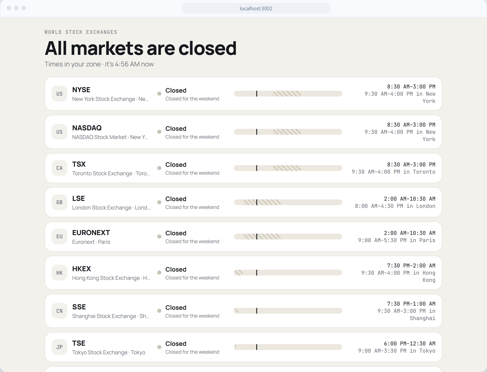

# Market Hours | APIVerve Template

[](LICENSE)
[](package.json)
[](tsconfig.json)
[](https://apiverve.com/marketplace/stockmarketopentimes?utm_source=github&utm_medium=template&utm_campaign=market-hours-nextjs-tutorial)

A world market clock you can deploy in one click: which stock exchanges are open right now, when the rest open or close, and every trading session drawn on a strip of your own day, in your own time zone.

[](https://vercel.com/new/clone?repository-url=https%3A%2F%2Fgithub.com%2Fapiverve%2Fmarket-hours-nextjs-tutorial&project-name=market-hours&repository-name=market-hours&env=APIVERVE_API_KEY&envDescription=Your%20APIVerve%20API%20key.%20Free%20to%20create%2C%20no%20card%20needed.&envLink=https%3A%2F%2Fdashboard.apiverve.com%2Fsignup%3Fapi%3Dstockmarketopentimes%26utm_source%3Dvercel%26utm_medium%3Dtemplate%26utm_campaign%3Dmarket-hours-nextjs-tutorial)



---

### Get your free API key

This template needs an APIVerve API key. **[Sign up free](https://dashboard.apiverve.com/signup?api=stockmarketopentimes&utm_source=github&utm_medium=template&utm_campaign=market-hours-nextjs-tutorial)**, no credit card required.

---

## Deploy in one click

Click **Deploy with Vercel** above. Vercel copies this repo to your GitHub account, asks for your `APIVERVE_API_KEY`, and gives you a live URL about a minute later.

## Run it locally

```bash
git clone https://github.com/apiverve/market-hours-nextjs-tutorial.git
cd market-hours-nextjs-tutorial
npm install
cp .env.example .env   # then set APIVERVE_API_KEY in .env
npm run dev
```

Open `http://localhost:3000`. To see it in a phone and a browser frame side by side, open `http://localhost:3000/showcase.html`.

## How it works

1. `components/MarketsApp.tsx` loads `/api/markets` once, converts each exchange's opening and closing time from its own zone to a real instant, and redraws every 30 seconds, so the open/closed state and countdowns stay live without new calls.
2. `app/api/markets/route.ts` asks Stock Market Open Times about nine exchanges in parallel. Your API key stays on the server and never reaches the browser. The combined answer is cached for an hour, and cached answers don't count against the rate limit.
3. Weekends and holidays come back from the API, so a closed day shows as a hatched session with the reason.

Every plan gets each exchange's name, session times and open state. Paid plans also return the exchange's time zone; the app keeps its own small zone map, so it works fully on a free key.

```
app/
  api/markets/route.ts   the server route: nine exchanges, cached
  layout.tsx             fonts and metadata
  page.tsx
  globals.css
components/
  MarketsApp.tsx         the board, time zone math and countdowns
lib/
  apiverve.ts            API call, cache and rate limit helpers
public/
  showcase.html          phone and desktop demo frame
```

### The API call

```ts
const res = await fetch('https://api.apiverve.com/v1/stockmarketopentimes?exchange=NYSE', {
  headers: { 'x-api-key': process.env.APIVERVE_API_KEY! }
});
const { data } = await res.json(); // data.isOpen, data.openingTime, data.closingTime
```

## Before you share your URL

Once deployed, anyone who finds your URL can use it on your API key. Each visitor can make 10 uncached requests a minute, and repeat lookups come from the cache, which is fine for a demo. Both are kept in memory, so they aren't shared between serverless instances. For production:

- Put the page behind your own sign-in, or
- Move the limit and cache to a shared store such as [Upstash Redis](https://upstash.com/), or
- Call the route only from your own backend.

## Ideas to extend it

- Add each market's headline index with [Stock Index](https://apiverve.com/marketplace/stockindex?utm_source=github&utm_medium=template&utm_campaign=market-hours-nextjs-tutorial)
- Show upcoming closures with [World Holidays](https://apiverve.com/marketplace/worldholidays?utm_source=github&utm_medium=template&utm_campaign=market-hours-nextjs-tutorial)
- Let visitors pin the exchanges they trade on

## API reference

- [Stock Market Open Times](https://apiverve.com/marketplace/stockmarketopentimes?utm_source=github&utm_medium=template&utm_campaign=market-hours-nextjs-tutorial): `GET https://api.apiverve.com/v1/stockmarketopentimes`
- [Full documentation](https://docs.apiverve.com?utm_source=github&utm_medium=template&utm_campaign=market-hours-nextjs-tutorial)

## Tech stack

- **Next.js 16** (App Router) and **React 19**, in **TypeScript**
- A **Route Handler** in `app/api/` for the server side, so the key never reaches the browser
- Deploys to Vercel as-is, with no configuration

## License

MIT. See [LICENSE](LICENSE).
